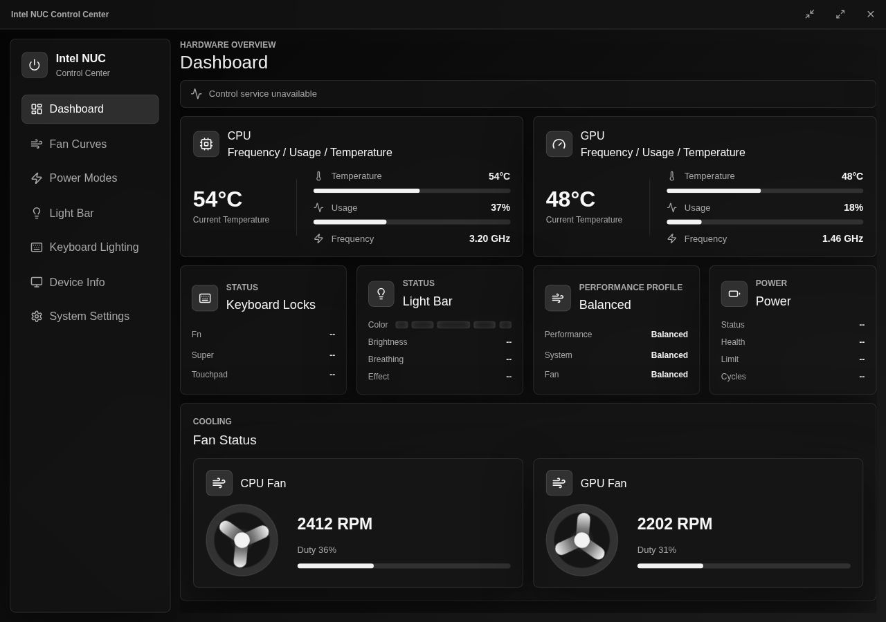
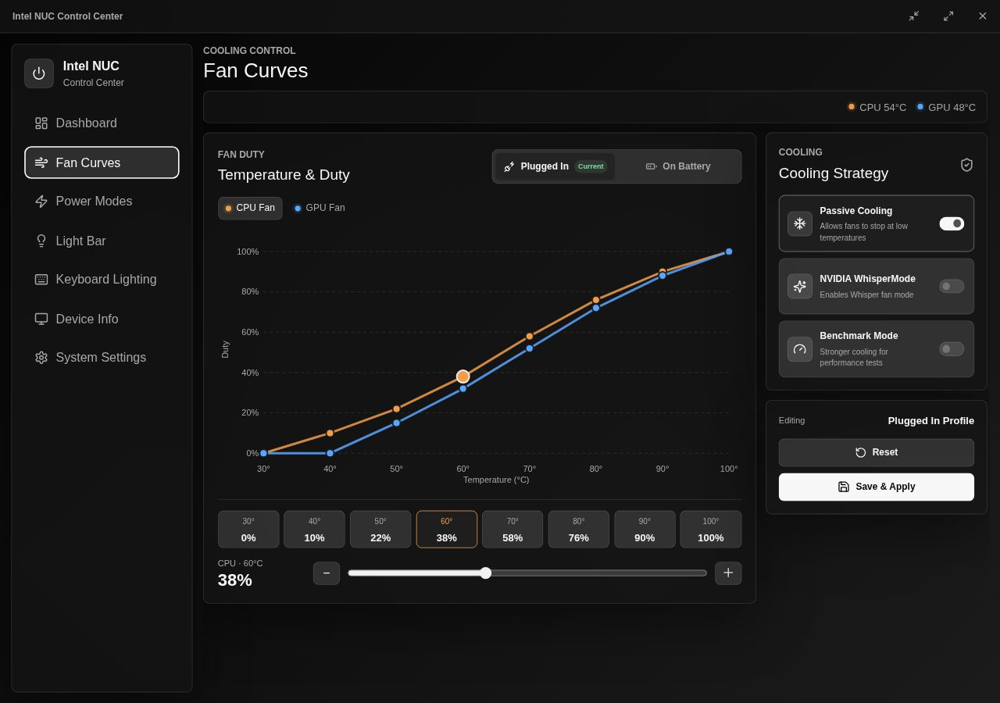
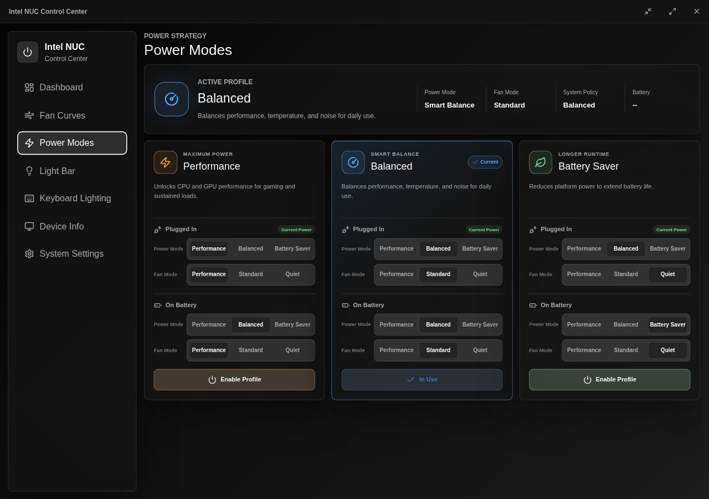
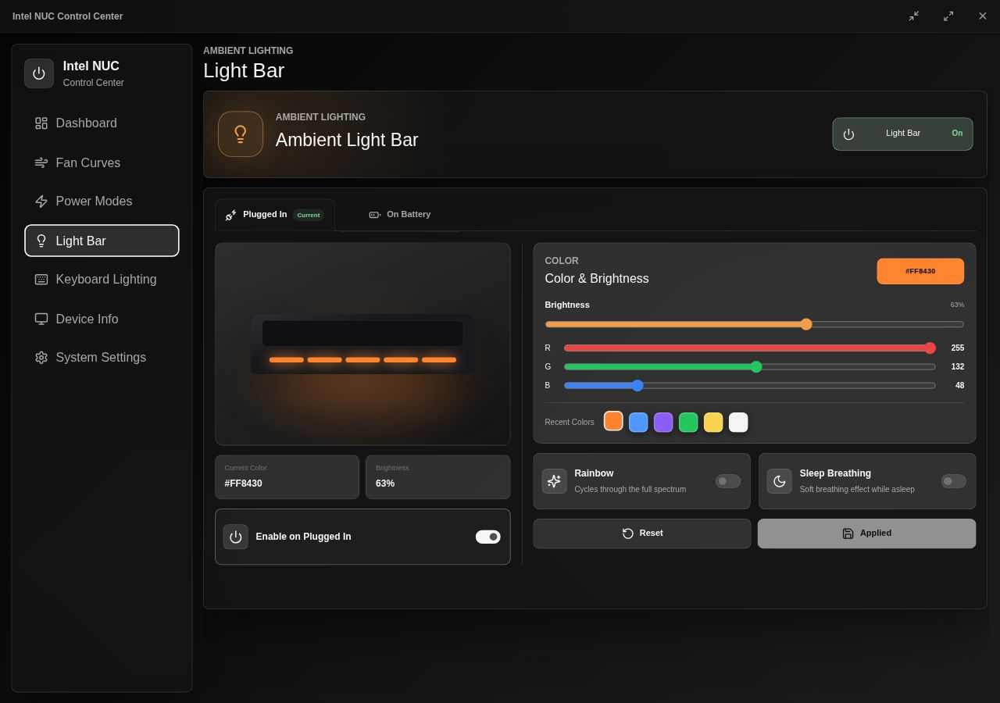
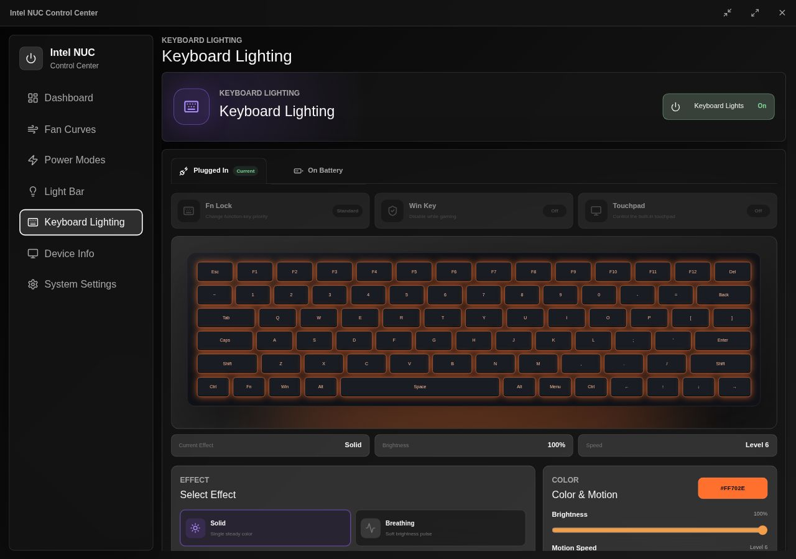
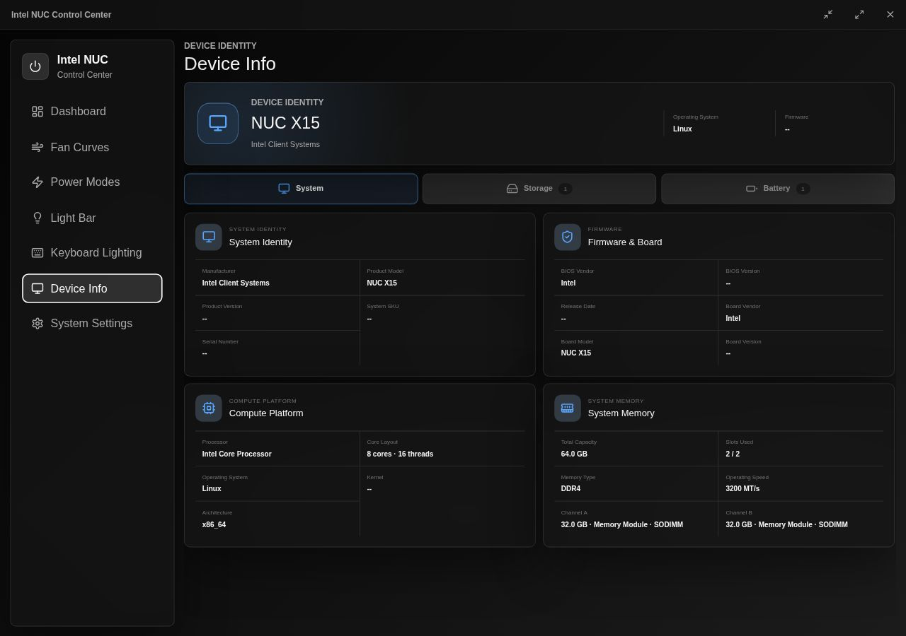
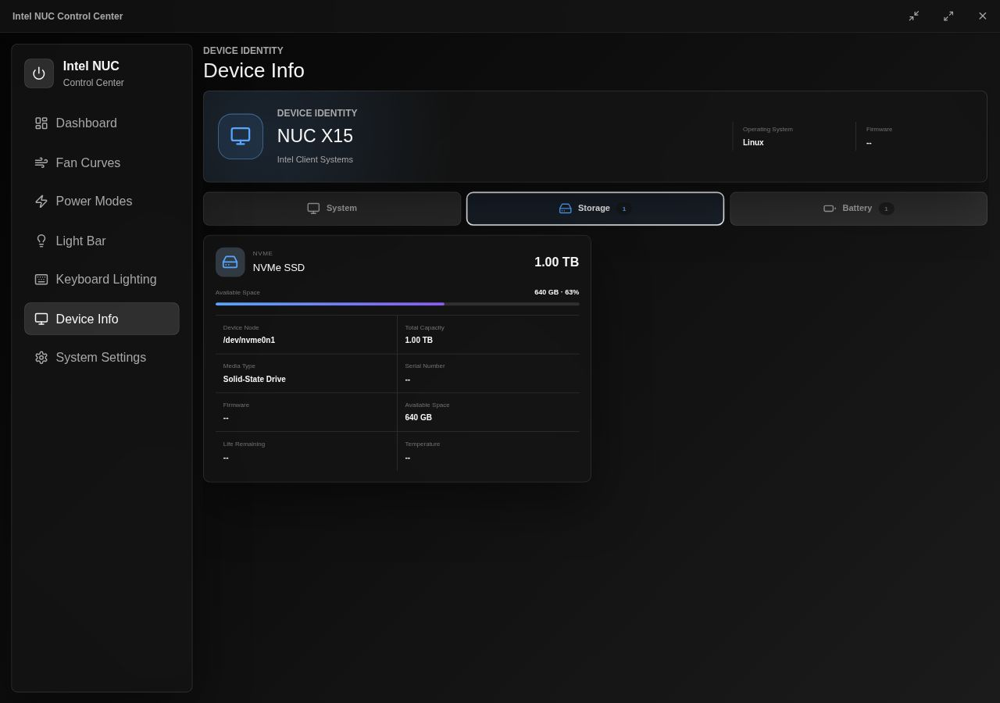
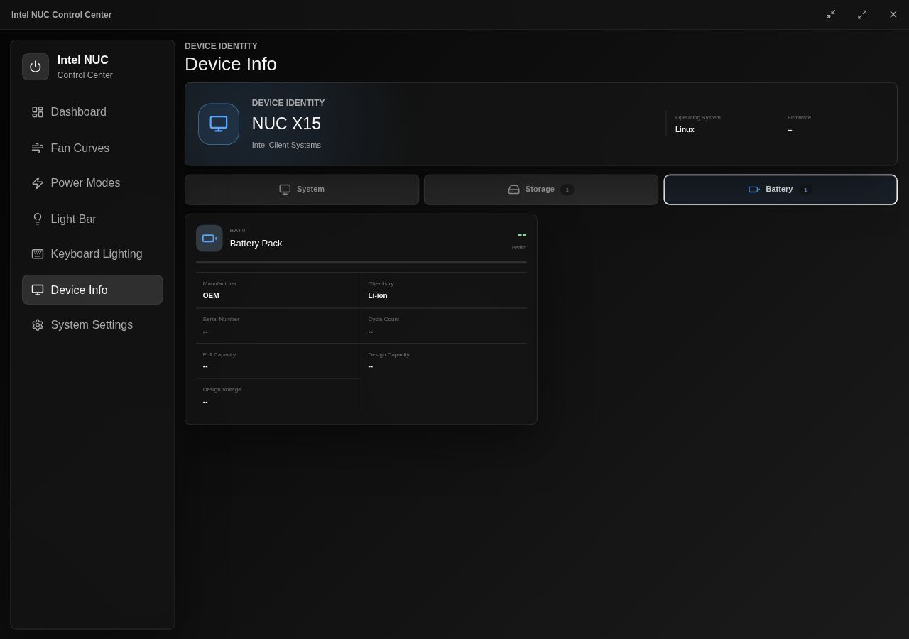
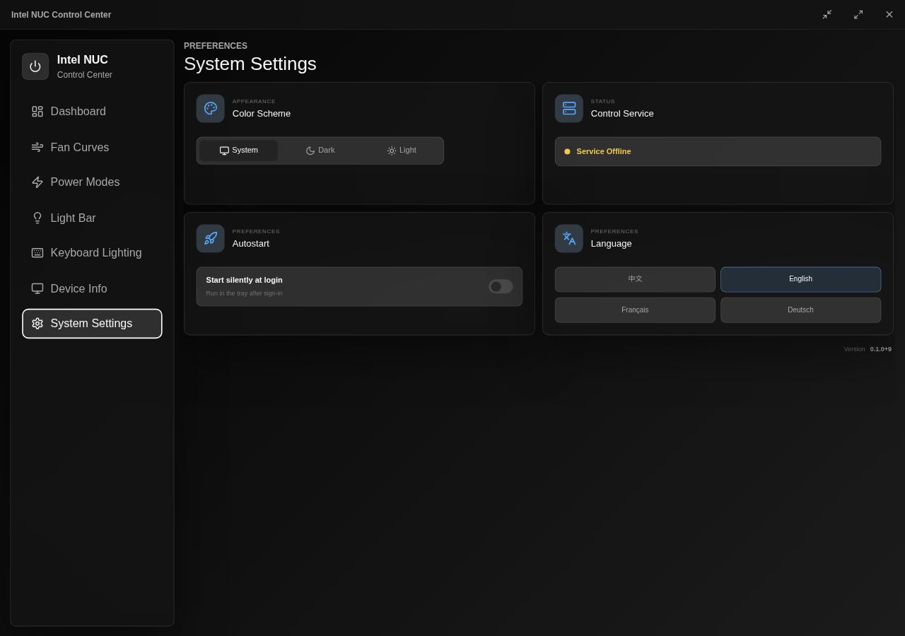

<p align="center">
  
</p>

<h1 align="center">Intel NUC Control Center</h1>

<p align="center">
  A modern Linux control center for compatible Intel NUC X15 and Uniwill-based laptops.
</p>

<p align="center">
  <a href="README.md">English</a> ·
  <a href="README.zh-CN.md">简体中文</a>
</p>

<p align="center">
  
  
  
  
  
</p>



## Overview

Intel NUC Control Center provides a focused desktop interface for the hardware controls exposed by
[dumingqiao/uniwill-laptop-dkms](https://github.com/dumingqiao/uniwill-laptop-dkms). It communicates with the
`uniwilld` service through its newline-delimited JSON API over `/run/uniwilld.sock`, using one
persistent full-duplex connection for commands, responses, and pushed state updates.

The product structure is inspired by the original Intel NUC control-center experience: a
dashboard-first layout, separate plugged-in and battery profiles, dedicated cooling and lighting
workspaces, and quick access from the system tray. The interface and implementation are independent
and designed specifically for a modern Linux desktop.

> This is an independent community project. It is not developed, sponsored, or supported by Intel.
> Intel and Intel NUC are trademarks of their respective owners.

## Highlights

| Area | Capabilities |
| --- | --- |
| Dashboard | CPU/GPU temperature, live usage and clock (NVIDIA dGPU read only while awake, never woken from D3cold), fan state, active power strategy, battery, keyboard locks, and light-bar status |
| Fan curves | Master on/off switch (off follows the power mode's firmware fan policy), smoothly ramped independent CPU/GPU curves, AC and battery profiles, passive cooling, NVIDIA WhisperMode, and benchmark cooling |
| Power modes | Persistent Performance, Balanced, and Battery Saver profiles with separate platform-power and fan modes |
| Light bar | Per-power-source enable state, RGB color, brightness, recent colors, rainbow, and sleep breathing |
| Keyboard lighting | Per-power-source lighting, brightness, motion speed, direction, reactive effects, and effect presets |
| Keyboard controls | Fn lock, Windows key, and touchpad switches |
| Device information | Static DMI system/memory data, firmware, physical storage, filesystem availability, SMART health, and battery data |
| System settings | Battery charge health control: full charge, 65% protection, and an adjustable custom limit when supported |
| Desktop integration | System tray controls, silent autostart, dark/light/system themes, and localized tray menus |
| Languages | Simplified Chinese, English, French, and German with first-run system-language detection |

## Screenshots

### Cooling and power

| Fan Curves | Power Modes |
| --- | --- |
| [](docs/screenshots/fan-curves.jpg) | [](docs/screenshots/power-modes.jpg) |

### Lighting

| Light Bar | Keyboard Lighting |
| --- | --- |
| [](docs/screenshots/light-bar.jpg) | [](docs/screenshots/keyboard-lighting.jpg) |

### Device information

| System and memory | Storage and SMART | Battery |
| --- | --- | --- |
| [](docs/screenshots/device-info-system.jpg) | [](docs/screenshots/device-info-storage.jpg) | [](docs/screenshots/device-info-battery.jpg) |

### System settings

[](docs/screenshots/system-settings.jpg)

## Architecture


The control center subscribes once and keeps the socket open. After a successful command or a real
hardware-state change, `uniwilld` pushes a complete daemon snapshot. The Rust layer merges fields
without invalidating unchanged values and emits an update to the React interface. There is no
short-lived command connection and no UI polling fallback.

The protocol used by this repository is documented in
[`doc/uniwilld-json-api.md`](doc/uniwilld-json-api.md). The upstream driver and daemon remain the
source of truth for hardware support.

## Requirements

- Linux on x86_64.
- A supported Intel NUC X15 or compatible Uniwill platform.
- [`uniwill-laptop-dkms`](https://github.com/dumingqiao/uniwill-laptop-dkms) `0.1.4-1` or newer, including
  the kernel module, udev rules, and `uniwilld` system service.
- GTK 3, WebKitGTK 4.1, and Ayatana AppIndicator runtime libraries.

Hardware capabilities vary by model and firmware. Unsupported endpoints remain unavailable in the
interface instead of being emulated.

## Installation

Download the package for your distribution from the GitHub Release associated with the desired
version tag. Install the companion driver package first if your package repository does not provide
it automatically.

### Arch Linux

```bash
sudo pacman -U ./nuc-x15-controller-<version>-x86_64.pkg.tar.zst
```

### Debian and Ubuntu

```bash
sudo apt install "./Intel NUC Control Center_<version>_amd64.deb"
```

### Fedora and RPM-based distributions

```bash
sudo dnf install "./Intel NUC Control Center-<version>.x86_64.rpm"
```

The native packages declare the appropriate `uniwill-laptop-dkms` dependency for their package
format.

## Build from source

Install the Tauri 2 Linux prerequisites for your distribution, together with a current Node.js LTS
release, npm, the stable Rust toolchain, and the native packaging tools.

```bash
git clone <repository-url>
cd nuc-x15-controller
npm ci
npm run build
cargo test --manifest-path src-tauri/Cargo.toml
```

Build Debian and RPM packages:

```bash
npm run build:linux-packages
```

Build the Arch Linux package on an Arch-based system:

```bash
./scripts/build-arch-package.sh
```

Packages are written to `src-tauri/target/release/bundle/`.

## Releases

The repository includes a tag-driven GitHub Actions workflow. Pushing any Git tag starts x86_64
builds for:

- Debian/Ubuntu (`.deb`)
- Fedora/RPM distributions (`.rpm`)
- Arch Linux (`.pkg.tar.zst`)

After all package jobs succeed, the workflow creates or updates the matching GitHub Release. The
release body uses the tag annotation as its introduction and appends commit hashes and commit
subjects since the previous tag.

## Upstream relationship

This repository is the desktop client. Hardware access, kernel integration, and the privileged
service live in [dumingqiao/uniwill-laptop-dkms](https://github.com/dumingqiao/uniwill-laptop-dkms). Contributions
that change the JSON protocol should keep both repositories and
[`doc/uniwilld-json-api.md`](doc/uniwilld-json-api.md) synchronized.
