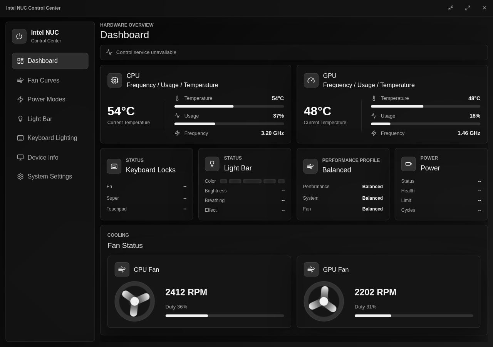
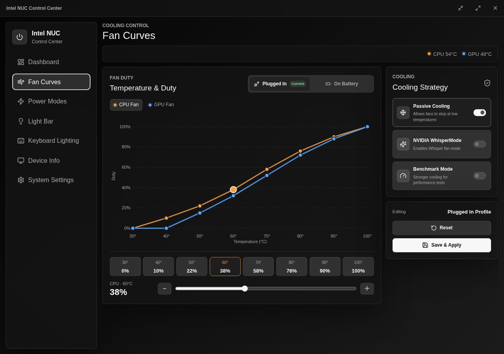
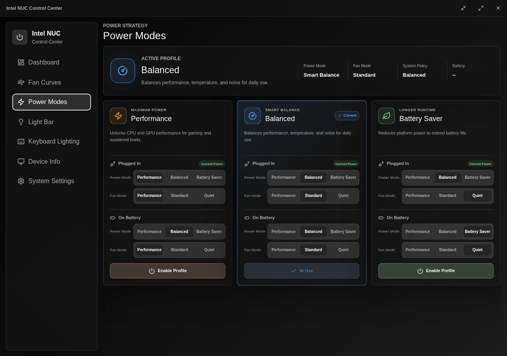
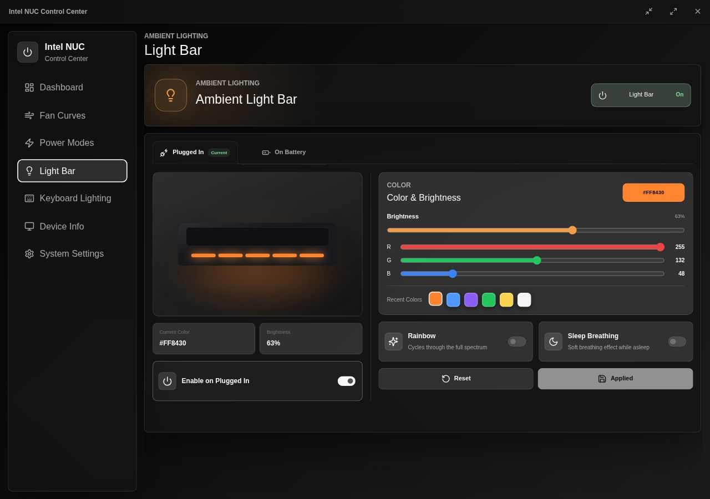
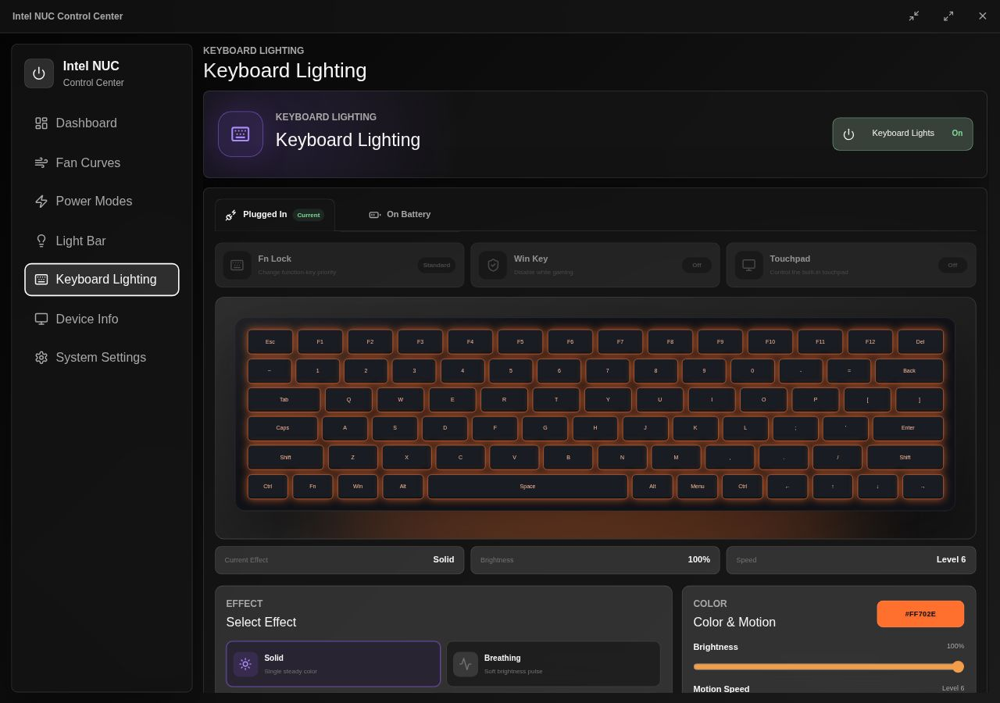
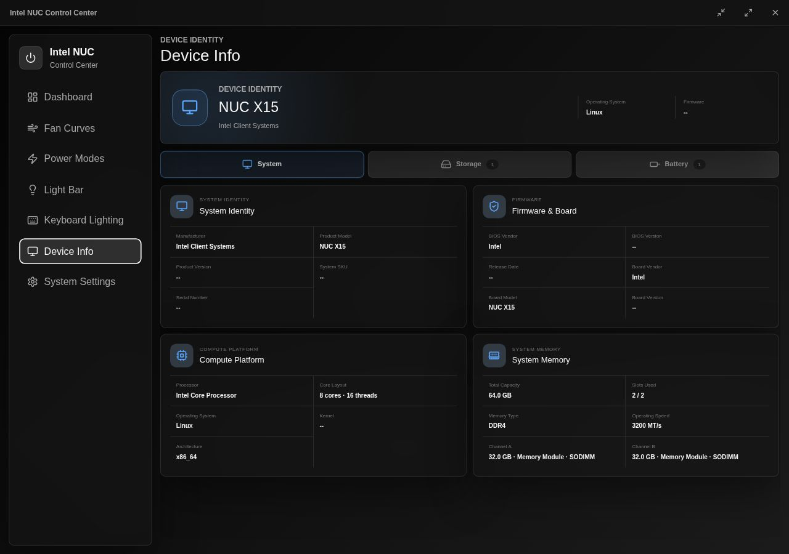
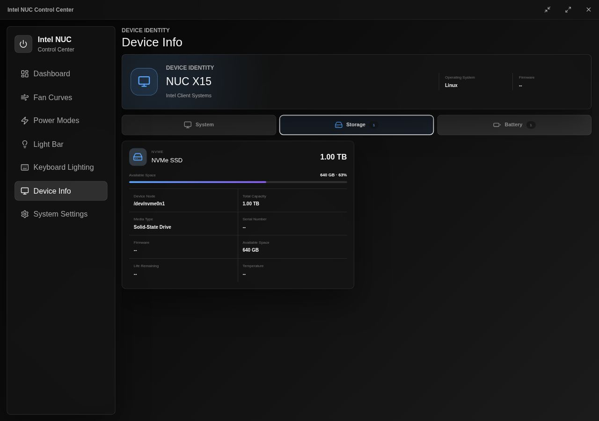
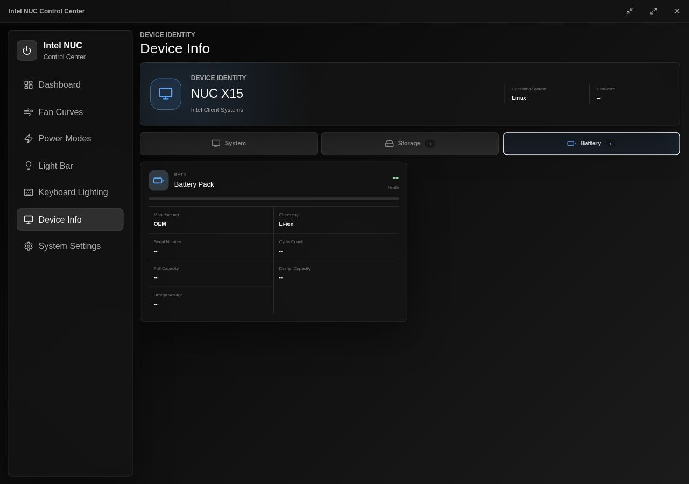
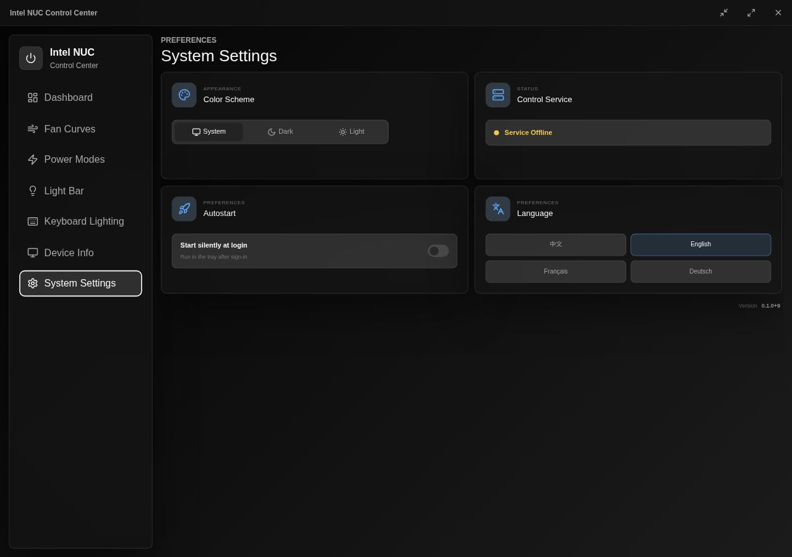
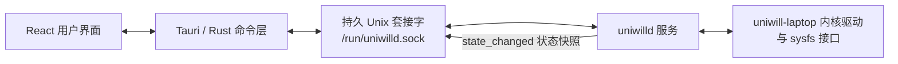

<p align="center">
  
</p>

<h1 align="center">Intel NUC Control Center</h1>

<p align="center">
  面向兼容 Intel NUC X15 与 Uniwill 笔记本的现代 Linux 控制中心。
</p>

<p align="center">
  <a href="README.md">English</a> ·
  <a href="README.zh-CN.md">简体中文</a>
</p>

<p align="center">
  
  
  
  
  
</p>



## 项目简介

Intel NUC Control Center 为
[dumingqiao/uniwill-laptop-dkms](https://github.com/dumingqiao/uniwill-laptop-dkms)
所提供的硬件控制能力构建了一套专注、完整的桌面界面。程序通过
`/run/uniwilld.sock` 使用换行分隔的 JSON API 与 `uniwilld` 通信，并保持一条持久双工连接，
统一承载命令、响应和服务主动推送的状态更新。

产品结构参考了官方 Intel NUC 控制中心的设计理念，包括以仪表盘为入口、分别配置接通电源和
使用电池时的策略、独立的散热与灯光工作区，以及托盘快捷操作。界面和代码均为独立实现，并针对
现代 Linux 桌面重新设计。

> 本项目是独立的社区项目，并非 Intel 官方开发、赞助或支持的软件。Intel 与 Intel NUC
> 是其各自权利人的商标。

## 功能概览

| 功能区域 | 功能 |
| --- | --- |
| 仪表盘 | CPU/GPU 温度、实时占用与主频（NVIDIA 独显仅在已唤醒时读取，不会唤醒 D3cold）、风扇状态、当前电源策略、电池、键盘锁定与灯条状态 |
| 风扇曲线 | 曲线总开关（关闭时使用当前电源模式的固件默认风扇策略）、平滑调速的 CPU/GPU 独立曲线、接通电源与电池配置、被动散热、NVIDIA WhisperMode 与基准测试散热 |
| 电源模式 | 持久化高性能、均衡、省电方案，每个方案分别配置平台功率模式和风扇模式 |
| 灯条设置 | 按电源来源启用、RGB 颜色、亮度、最近颜色、彩虹和睡眠呼吸效果 |
| 键盘灯效 | 按电源来源配置、亮度、动态速度、方向、按键响应与多种灯效 |
| 键盘控制 | Fn 锁定、Windows 按键和触摸板开关 |
| 设备信息 | DMI 系统与内存、固件、物理磁盘、文件系统可用空间、SMART 健康与电池信息 |
| 系统设置 | 充电健康控制：完全充满、65% 保护和自定义充电上限；仅在电池支持阈值控制时可用 |
| 桌面集成 | 托盘快捷控制、开机静默启动、系统/深色/浅色主题和多语言托盘菜单 |
| 多语言 | 简体中文、英文、法文和德文，首次启动自动匹配系统语言 |

## 界面截图

### 散热与电源

| 风扇曲线 | 电源模式 |
| --- | --- |
| [](docs/screenshots/fan-curves.jpg) | [](docs/screenshots/power-modes.jpg) |

### 灯光

| 灯条设置 | 键盘灯效 |
| --- | --- |
| [](docs/screenshots/light-bar.jpg) | [](docs/screenshots/keyboard-lighting.jpg) |

### 设备信息

| 系统与内存 | 存储与 SMART | 电池 |
| --- | --- | --- |
| [](docs/screenshots/device-info-system.jpg) | [](docs/screenshots/device-info-storage.jpg) | [](docs/screenshots/device-info-battery.jpg) |

### 系统设置

[](docs/screenshots/system-settings.jpg)

## 软件架构



控制中心只订阅一次并持续保持连接。成功执行命令或硬件状态真实变化后，`uniwilld` 会主动推送完整
的服务端状态快照。Rust 层按字段合并数据，不会让未变化的状态失效，然后向 React 界面发送更新。
程序不使用短连接，也没有界面轮询兜底。

本仓库使用的协议记录在
[`doc/uniwilld-json-api.md`](doc/uniwilld-json-api.md) 中；硬件支持范围以底层驱动和服务为准。

## 运行要求

- x86_64 Linux。
- 受支持的 Intel NUC X15 或兼容 Uniwill 平台。
- [`uniwill-laptop-dkms`](https://github.com/dumingqiao/uniwill-laptop-dkms) `0.1.4-1`
  或更高版本，包含内核模块、udev 规则和 `uniwilld` 系统服务。
- GTK 3、WebKitGTK 4.1 与 Ayatana AppIndicator 运行库。

不同机型和固件提供的硬件能力可能不同。未被底层支持的接口会在界面中保持不可用，不会使用模拟
实现代替。

## 安装

从目标版本 Tag 对应的 GitHub Release 下载适合发行版的安装包。如果软件源不能自动提供配套
驱动包，请先安装 `uniwill-laptop-dkms`。

### Arch Linux

```bash
sudo pacman -U ./nuc-x15-controller-<版本>-x86_64.pkg.tar.zst
```

### Debian 与 Ubuntu

```bash
sudo apt install "./Intel NUC Control Center_<版本>_amd64.deb"
```

### Fedora 与其他 RPM 发行版

```bash
sudo dnf install "./Intel NUC Control Center-<版本>.x86_64.rpm"
```

不同格式的原生安装包会声明各自对应的 `uniwill-laptop-dkms` 依赖。

## 从源码构建

请先安装当前发行版所需的 Tauri 2 Linux 构建依赖，以及 Node.js LTS、npm、稳定版 Rust
工具链和原生打包工具。

```bash
git clone <仓库地址>
cd nuc-x15-controller
npm ci
npm run build
cargo test --manifest-path src-tauri/Cargo.toml
```

构建 DEB 与 RPM：

```bash
npm run build:linux-packages
```

在 Arch Linux 环境构建 Arch 软件包：

```bash
./scripts/build-arch-package.sh
```

生成的软件包位于 `src-tauri/target/release/bundle/`。

## 自动发布

仓库包含由 Tag 驱动的 GitHub Actions 工作流。推送任意 Git Tag 后会开始构建以下 x86_64
软件包：

- Debian/Ubuntu（`.deb`）
- Fedora/RPM 发行版（`.rpm`）
- Arch Linux（`.pkg.tar.zst`）

全部构建成功后，工作流会创建或更新同名 GitHub Release。发布说明首先使用 Tag 的说明文字，
然后附上自上一个 Tag 以来的提交哈希和提交信息。

## 与底层项目的关系

本仓库是桌面客户端。硬件访问、内核集成和特权服务位于
[dumingqiao/uniwill-laptop-dkms](https://github.com/dumingqiao/uniwill-laptop-dkms)。
如果修改 JSON 协议，请同步维护两个仓库以及
[`doc/uniwilld-json-api.md`](doc/uniwilld-json-api.md)。
